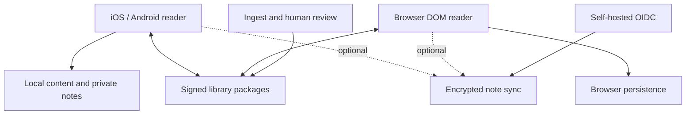

# Architecture and decisions

Status: proposed baseline; the first phase contains mandatory feasibility spikes.

## Components

The diagram shows data boundaries, not a requirement that all components run together. Public library content and encrypted personal records have separate stores and APIs.

## Proposed technology choices

Revision 5 replaces the TypeScript-first baseline; see docs/adr/0001-rust-core-native-ui.md and specs/18-platform-capabilities.md.

| Layer | Baseline | Decision gate |
|---|---|---|
| Core | Rust workspace (`crates/`): references, versification mappings, anchors, packages, search/retrieval, collections, sync log | Conformance fixtures pass identically through every binding |
| Bindings | UniFFI to Swift/Kotlin [S44]; `wasm-bindgen` to web and Obsidian; native linking for Tauri | Versioned core API; binding generation in CI |
| Apple (iPadOS, macOS, iOS) | One SwiftUI app; TextKit 2 reading surface [S45] | Real-device cross-verse selection, Hebrew/RTL, VoiceOver, Pencil and three-pane performance |
| Android | Kotlin + Jetpack Compose; platform text stack reading surface | Same conformance gate; follows Apple |
| Web | Thin TypeScript UI over semantic DOM; core as WebAssembly in a worker | DOM selection, keyboard/a11y and offline persistence on Safari |
| Windows/Linux desktop | Tauri shell [S46] over the web UI with the native core | Window management, file access and vault access tests |
| Storage, search, vectors, relations | Decided in specs/19-search-and-retrieval.md (ADR 0002) | Benchmarks on the declared corpus fixture |
| Optional services | Rust HTTP services + PostgreSQL | Multi-user isolation, opaque sync storage, backups |
| Ingestion | Rust deterministic build pipeline producing signed packages and prebuilt indexes; Python only for ML/OCR/evaluation experiments | Reproducible rebuild produces identical hashes |
| Identity | Self-hosted Keycloak via standard OIDC | Discovery/PKCE/provider migration and recovery tests |
| Network | HTTPS; OS Tailscale or Headscale; plain WireGuard routes | All modes tested independently |
| Hosting | NixOS modules, static server/reverse proxy, systemd | Fresh-machine deployment and restore test |

These are defaults to test, not claims of finished quality. Interface layers stay thin: anything that changes data or results lives in the core. React Native, Flutter and custom GPU text renderers were considered and rejected for the reading surface (ADR 0001); they are not contingency defaults.

SQLite browser persistence varies by VFS and browser [S16]. Do not promise native/web storage equivalence. Cross-origin isolation headers can affect authentication popups and embedded content; use redirect-based auth and test deployment combinations. Bundle reader fonts/assets locally. Expose storage usage, persistence status, export and recovery. Browser eviction, origin changes and private mode can remove local data; an exported backup or optional sync is needed for durability. A web origin change is a migration, not just a DNS edit.

## Offline and server boundaries

Guest/local identity is a device-generated opaque ID; installed books and notes never expire because login does. A user may later link local state to a self-hosted identity after explicit confirmation. No central account directory exists.

A minimal reader installation has **zero application servers** after initial installation. A static web deployment serves code and approved packages. A personal hub adds identity and encrypted sync. A maintainer installation adds ingestion, review and package publication. Running a maintainer pipeline is never required for a family to host the reader.

The server uses PostgreSQL relational tables for graph nodes/claims and jobs. Devices receive prebuilt, signed index layers inside packages (specs/19-search-and-retrieval.md). Embeddings are optional rebuildable indexes, never canonical evidence. Corpus AI work runs as bounded background jobs. User research runs as cancellable interactive sessions with explicit scope and budgets; neither blocks the reading/render path.

## API contracts to implement

- Catalog: fetch signed versioned index, metadata search locally, fetch packages by content hash; no account required for public approved packages.
- Package transfer: manifest → policy validation → requested chunk hashes → verified chunks → atomic installation. Content capabilities limited to explicit selection.
- Sync: authenticated device enrollment, append opaque encrypted operations with idempotency key, pull by opaque cursor, acknowledgement, revocation and bounded retention. Authorization is server-enforced; crypto validation is client-enforced.
- Review: job status, evidence retrieval, propose/approve/reject/supersede claim. The inference worker cannot call the publish endpoint.
- Export: versioned local archive, all note revisions and original anchors, optional attachments and allowed quotations. Export works offline with server unavailable.

Version all protocols; publish JSON Schema/OpenAPI plus conformance fixtures. Schema migrations are forward-tested and recoverable. An old client rejects an unsupported package version cleanly without altering its current library.

## Code and content licensing proposal

MPL-2.0 for first-party client/domain code; AGPL-3.0-or-later for first-party hosted services; a separate permissive specification/documentation license selected before public release. These are proposals for the project owner, not licenses asserted over upstream content. Keep imported datasets under their own verified licenses with per-layer notices. Do not link/copy GPL code into a differently licensed component without compatibility review; process separation alone does not settle derivative-work questions. Inspiration from AndBible/Ezra/SWORD is easy; code reuse needs a deliberate license decision, including iOS distribution implications.

Every maintained first-party feature is available in source. Optional external integrations (Obsidian, provider APIs and provider CLI runtimes) are identified separately from the open core. Reading, notes, ink and local search require no proprietary server; research also supports an optional local model. Provider subscription clients are not relabeled open source or required by core builds. If translation research uses hosted models, disclose reproducibility limits and offer a local backend.

## Revision 2 components

Add a persistent workspace/pane model, notes repository interface (app-managed or vault-backed), optional Obsidian plugin and personal companion, portable ink/snapshot storage, and a research thread/provider adapter layer. Obsidian and provider bridges are independently installable adapters; the core reader stays usable without them. The personal research companion is distinct from the blind encrypted-sync service because inference can require access to user-approved plaintext. Secrets never travel in ordinary annotation sync or public packages. See specs/12-workspace-ux.md through specs/14-research-assistant.md.

## Revision 3 study boundary

Collection assembly and deterministic search are local domain features. The Obsidian plugin shares reference/package contracts and receives selected resources through a tested local path or explicit file transfer. Only the user-selected resource folder/managed blocks are writable by default. The user's external manuscript is never the application's document store. No server or LLM is required for collection assembly or handoff. Obsidian is the sole first-class writing integration; ordinary exports keep other tools usable without additional adapters.
